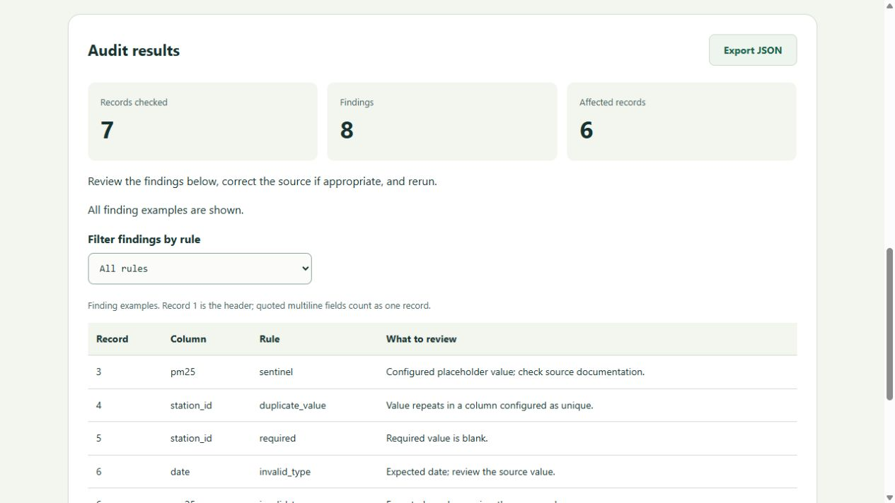

# CSV Triage

**Understand a CSV's problems before importing or analysing it.**

A local data-quality workbench with a Python validation engine, command-line interface, JSON API, browser dashboard and optional SQLite report history. It checks explicit rules and produces reproducible evidence without editing the source data or sending it to external services.

Status: **working initial prototype**. The demo is synthetic. No user adoption or production readiness is claimed.



## Try it

Requires Python 3.11+; **no third-party dependencies or API keys**.

```sh
python server.py
```

Open <http://127.0.0.1:8765>, choose **Load demo**, then **Run audit**. The seven synthetic records contain eight seeded findings. Filter by rule and export the JSON report.

```sh
python audit.py demo.csv --schema demo-schema.json
python audit.py input.csv --schema rules.json --output report.json
python audit.py corrected.csv --schema rules.json --baseline report.json
python server.py --db reports.sqlite
python -m unittest -v
```

CLI exit codes: `0` = complete audit with no findings; `1` = findings or ambiguous header; `2` = invalid input, configuration or I/O error. This makes it usable in CI. A zero exit code means only that the configured checks passed.

## What it catches

- Duplicate/blank headers and missing configured columns
- Blank records and inconsistent record widths
- Leading/trailing whitespace, with no automatic trimming of the source
- Missing required values and repeated values in unique columns
- Explicitly configured sentinel values such as `-9999`
- Invalid integers, finite numbers and ISO calendar dates
- Values outside inclusive numeric bounds, including coordinate ranges

Zero is a legitimate value. Negative values are not assumed to be missing. Unconfigured columns are not assigned inferred types. A date is a calendar date (`YYYY-MM-DD`), not a timestamp. Unique-value checks use trimmed text and are case sensitive; for numeric uniqueness, `01` and `1` are distinct.

## Configure rules

```json
{
  "delimiter": ",",
  "columns": {
    "id": {"required": true, "unique": true},
    "observed_on": {"type": "date", "required": true},
    "measurement": {"type": "number", "min": 0, "sentinels": ["-9999"]}
  }
}
```

See [demo-schema.json](demo-schema.json). The schema is a deliberately small custom format, not a Frictionless Table Schema implementation. The demo's unique station ID rule is illustrative: a real time-series dataset normally needs a composite station/date key. Always adapt rules to source documentation.

## Architecture

```text
CSV + explicit schema -> audit.py -> versioned JSON report
                              ^              |
CLI --------------------------|              +-> optional SQLite
Browser -> POST /api/audit ----|              +-> export / baseline counts
```

`audit.py` is independent of the UI and HTTP layer. `server.py` serves a fixed asset allowlist and a small API. `app.js` renders untrusted fields with `textContent`, not HTML. Reports contain counts, record positions, rule names, column names and remediation hints, without raw cell values.

`GET /api/health` returns status; `GET /api/demo` returns the synthetic fixture; `POST /api/audit` accepts `{"csv":"...","schema":{...}}` and returns a report. Invalid requests return a 4xx JSON error. Raw CSV is not written to SQLite; persistence is opt-in. SQLite can be queried directly for saved reports; there is no history browser yet.

## Why this problem

Open data is available through [Belgium's portal](https://data.gov.be/en) and the [EU data portal](https://data.europa.eu/en/news-events/news/open-data-portals-around-europe-unveiling-belgiums-open-data-landscape). Structural and semantic CSV errors are documented in the [Frictionless validation guide](https://framework.frictionlessdata.io/docs/guides/validating-data.html). Mature tools such as Frictionless and Great Expectations already address validation. This project explores a small, dependency-free local workflow and explainable reports; it does not claim to replace them or fill a proven market gap.

See [RESEARCH.md](RESEARCH.md) for the opportunity review and [ROADMAP.md](ROADMAP.md) for the next milestones. The hypothesis that students or small civic-data teams need this workflow still requires interviews and real-data trials.

## Validation and limitations

See [VALIDATION.md](VALIDATION.md). UTF-8 CSV only; configurable one-character delimiter; 5 MB, 100,000 records and at most 500 stored finding examples. Counts cover all findings. Record numbers count CSV records, not physical lines, so quoted multiline values remain one record. Blank lines count as records.

Hashes cover decoded CSV text and canonical configuration. Reading files can normalise line endings, so `source_sha256` is **not necessarily the original file-byte hash**. Baseline comparison requires matching schema hashes and complete reports; it compares aggregate rule counts and does not establish which individual records were fixed. Duplicate/blank headers stop value validation with `complete=false`.

This is a local development server: no authentication, TLS or deployment hardening. Bind it to loopback and do not expose it publicly. No URL fetching or scraping is implemented. Reports still expose column names and record positions; review them before sharing. Huge files, Excel, automatic repair, inferred schemas, composite keys, timestamp freshness and production hosting are outside this first slice.

## Contributing

Run `python -m unittest -v` before changes. Include a failing fixture and a regression test for a validation bug. Discuss source licences before adding real datasets. Keep demo records synthetic, and never commit private data, reports, databases, tokens or `.env` files.

Licensed under MIT.
